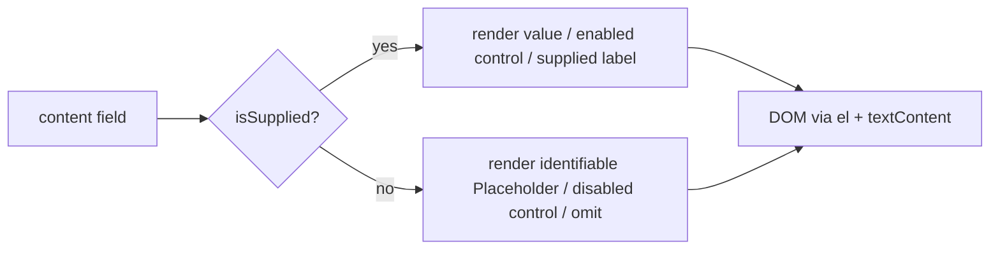

# Design Document

## Overview

This is an art-directed visual redesign of the existing, working single-page portfolio for Prem Chandu Appala. It keeps the whole machine intact — Vite build, vanilla ES modules, `src/data/content.js` as the single source of truth, the per-section renderers in `src/js/render.js`, the injection-safe helpers in `src/js/dom.js`, the fixed CSS layer cascade, and every one of the 18 currently passing tests in `tests/properties.test.js` — and changes only the visual identity, composition, and a handful of renderer/content additions that those tests already tolerate.

The target identity is a premium editorial piece: a deep midnight-charcoal canvas, warm off-white type, a restrained emerald-green accent, a sparingly used warm champagne detail color, muted gray-green supporting tones, fine low-contrast borders, an oversized editorial display face for the masthead and section titles, a monospace for eyebrow numbering / tags / metadata, and generous negative space. The accent moves from the current teal-mint `#2DD4A6` to a genuinely greener emerald, and the supporting neutrals warm up — every one of those color moves is proven against the exact WCAG algorithm the test suite runs.

**Refinement update (Phase 3).** This document was authored for the original redesign; the Phase 3 refinement updates it in place. Three things change from the text as first written: (1) the surface, foreground, and border palette values below are the applied values (the recolor already shipped and runs green), not the original pre-redesign values; (2) a single new decorative token `--accent-warm` (warm champagne `#D6B779`) is added for small editorial marks, keeping emerald as the sole interactive accent; and (3) the requirement set grows from 18 to 20 with Requirement 19 (Visual Refinement Pass) and Requirement 20 (CSS Cleanup And De-duplication). Where older passages still say "18", read "20".

Three constraints govern every decision below, in priority order:

1. **The test suite stays green (Requirement 18.1).** `tests/properties.test.js` is treated as a contract. The redesign never renames the class hooks it asserts (`project-card`, `project-card__cta`, `project-card__stack .tag`, `skill-group` / `skill-group__title` / `tag`, `contact__email`, `resume__note`, `is-placeholder`, `footer__copy`, `nav__link`, `[data-render]`, `[data-reveal]`), never weakens the honesty branches, and re-proves the palette after the recolor.
2. **The Honesty_Contract (Requirement 17).** Only Supplied Values render. New surfaces introduced by the redesign — the hero headline, project category labels, project previews, project numbering — are either reviewed-and-supplied content, honest UI chrome (section indices), or decorative sketches that carry no data.
3. **Architecture and CSS layering are preserved (Requirement 16).** Token changes land in `tokens.css`, reusable component changes in `components.css`, section-specific changes in `sections.css`. Part of this work is *moving* the makeover rules that currently sit in `polish.css` back into the layer that matches their concern.

### Verification constraints in this environment

This design is honest about what could and could not be checked while writing it:

- **No browser / visual verification was available.** Line-wrapping, overflow, spacing rhythm, and the look of the previews are reasoned from geometry and the token system, not confirmed on screen. The responsive and layout guarantees below are stated as *construction guarantees* and are flagged for a manual resize pass.
- **The named reference sites could not be inspected (the fetch timed out).** Nothing here is copied from a reference; the composition, the headline wording, and the preview sketches are original.
- **Contrast is the exception — it is computed, not eyeballed.** Every ratio in the Color System section was calculated with the same sRGB relative-luminance formula `tests/properties.test.js` uses, so those numbers are trustworthy and the suite's Property 12 will pass with the new values.
- **No deploy, no push.** Verification is limited to `npm run build` and `npm test`.

### MVP vs future polish

The **MVP satisfies all 20 requirements**: recolored and warmed token palette (proven), self-hosted display/sans/mono with graceful fallback, the reviewed hero headline, the two art-directed project showcases with custom CSS mini-UI previews, the editorial section-head/number treatment, the responsive breakpoint rules, the accessibility and motion guarantees, and the CSS-layer migration out of `polish.css`. **Future polish** (explicitly optional, none required for the 18): SVG-accented previews via a namespaced helper, a reduced-motion-safe parallax on the hero wash, per-letter display kerning, and additional display weights. The MVP ships on a lean font bundle and the default static Vite build.

## Architecture

Nothing structural changes. The redesign maps cleanly onto the parts that already exist.

| Concern | Stays as-is | What the redesign touches |
| --- | --- | --- |
| Single page shell | `index.html` with header / main / footer landmarks, seven sections `#hero…#contact`, `[data-render]` hooks, `[data-nav-*]` hooks, skip link | Add ONE `<link rel="preload">` for the hero display font in `<head>` (conditional — see Typography) |
| Content source of truth | `src/data/content.js` | Add `profile.heroHeadline`, `project.category`, `project.preview` (all Supplied Values / honest keys) |
| Render dispatch | `renderAll` + one renderer per section in `src/js/render.js` | Extend `renderHero` (eyebrow + headline), `renderProjects` (number, category, CSS mini-UI preview); all keep their asserted hooks |
| DOM helpers | `isSupplied`, `el`, `placeholder`, `externalLink`, `mountInto` in `src/js/dom.js` | Reuse unchanged; the preview builder is pure `el(...)`, no `innerHTML` |
| Behaviors | `nav.js`, `scrollReveal.js`, `activeLink.js`, `icons.js`, wired by `main.js` | Unchanged |
| CSS cascade | `tokens → reset → base → layout → components → sections → utilities → polish` imported by `main.js` | Same files, same order; rules migrated into the correct layer |
| Build | Vite static build, Lucide tree-shaken to 3 icons | Self-host fonts; no new framework or animation library |

### Data flow for a single field (unchanged honesty gate)



The redesign adds no bypass around this gate. The hero headline, project category, and project-number elements all pass their content through `isSupplied` / `textOrPlaceholder`; the project previews carry no content at all (decorative).

### Hero section renderer, before → after

```text
BEFORE (renderHero)                        AFTER (renderHero)
div.hero[data-reveal]                       div.hero[data-reveal]
  h1.hero__name        (name)                 p.hero__eyebrow   (role, mono accent)   ← from profile.headline
  p.hero__headline     (role string, mono)    h1.hero__name     (name, display)       ← KEEPS the single h1 + name
  p.hero__tagline      (tagline)              p.hero__headline  (oversized display statement) ← from profile.heroHeadline
  div.hero__actions    (2 CTAs)               p.hero__tagline   (supporting paragraph) ← from profile.tagline
                                              div.hero__actions (2 CTAs, unchanged hrefs/labels)
```

The `<h1>` still exists and still contains `profile.name`; the two `a.btn` CTAs still carry `#projects` / `#contact` and the labels "Explore Projects" / "Contact Me" — so the shipped hero regression and the whole-page integration test are unaffected. The role string moves up into a mono accent eyebrow (the restrained accent element of Requirement 5.8); the new oversized editorial line takes the `hero__headline` slot.

## Color System

All color lives in `src/styles/tokens.css` as `:root` custom properties; no downstream layer hardcodes a color. The redesign recolors three things — the accent (to emerald green), the foreground tints (to warm off-white + muted gray-green) — and keeps every token **name**. Surfaces, borders, and foreground values are the applied refinement values; a single decorative champagne token (`--accent-warm`) is added while emerald remains the only interactive accent.

### Why this is the #1 constraint

`tests/properties.test.js` → **Property 12** reads `tokens.css` straight off disk, parses every `--name: #hex` declaration, and asserts seven pairings with the exact sRGB relative-luminance formula (`c/12.92` below 0.03928, else `((c+0.055)/1.055)^2.4`; ratio `(L_light+0.05)/(L_dark+0.05)`). Any recolor that misses a threshold fails the build. Every value below was computed with that same formula.

### Token values (changed lines shown; names preserved)

```css
:root {
  /* Surfaces — deep midnight charcoal (refined, warmer ramp) */
  --surface-0: #101211; /* page background */
  --surface-1: #191D1A; /* cards, nav bar */
  --surface-2: #202520; /* hover / raised */
  --surface-3: #2A312A; /* inset wells */

  /* Foreground — warm off-white + muted gray-green (CHANGED hues, same names) */
  --fg:        #F2EEE6; /* warm off-white  — Req 1.3 "warm off-white body text" */
  --fg-muted:  #A6ADA5; /* muted gray-green — Req 4.6 */
  --fg-subtle: #828E82; /* muted gray-green — Req 4.6 */

  /* Accent — restrained EMERALD GREEN (greener than the prior #2DD4A6 teal-mint) */
  --accent:       #2ECC71; /* Req 4.5 — emerald family, name kept */
  --accent-hover: #5CE39A; /* lighter emerald for hover/active (not a tested pairing) */
  --accent-soft:  rgba(46, 204, 113, 0.12); /* re-derived from the new accent RGB */
  --on-accent:    #06231F; /* near-black green label on accent fills (UNCHANGED) */

  /* Detail - warm champagne; DECORATIVE editorial marks only, never interactive (Req 4.10, 4.11) */
  --accent-warm:  #D6B779; /* 9.77:1 on --surface-0, 8.85:1 on --surface-1 */

  /* Borders (refined) */
  --border:        #303830;
  --border-strong: #6E7B8A;

  /* Status (UNCHANGED) */
  --placeholder-fg: #C9A24B;

  /* Elevation — re-derive the accent glow from the new accent RGB */
  --glow-accent: 0 0 0 1px var(--accent-soft), 0 8px 32px rgba(46, 204, 113, 0.12);
}
```

**Non-hex accent-derived values must track the new hue.** These are not picked up by Property 12's hex regex, but they must change for visual consistency:

- `--accent-soft`: `rgba(45,212,166,0.12)` → `rgba(46,204,113,0.12)`
- `--glow-accent` literal: `rgba(45,212,166,0.12)` → `rgba(46,204,113,0.12)`
- `polish.css` body wash literal: `rgba(45,212,166,0.07)` → `rgba(46,204,113,0.07)` (migrated into the body-backdrop rule; see Editorial Layout).

### Contrast verification (computed with the suite algorithm)

The refinement keeps every token name and re-proves the seven Property 12 pairings against the applied palette (surfaces #101211 / #191D1A / #202520 / #2A312A, foreground #F2EEE6 / #A6ADA5 / #828E82, accent #2ECC71, on-accent #06231F, border-strong #6E7B8A). Two extra rows cover the new champagne token.

| # | Pairing | Computed ratio | Threshold | Pass | Requirement |
| --- | --- | --- | --- | --- | --- |
| 1 | `--fg` `#F2EEE6` on `--surface-0` `#101211` | 16.25:1 | >= 4.5 | PASS | 4.2 |
| 2 | `--fg-muted` `#A6ADA5` on `--surface-0` | 8.19:1 | >= 4.5 | PASS | 4.2, 4.6 |
| 3 | `--fg-subtle` `#828E82` on `--surface-0` | 5.50:1 | >= 4.5 | PASS | 4.2, 4.6 |
| 4 | `--accent` `#2ECC71` on `--surface-0` | 8.95:1 | >= 4.5 | PASS | 4.2, 4.5 |
| 5 | `--on-accent` `#06231F` on `--accent` `#2ECC71` | 7.88:1 | >= 4.5 | PASS | 4.3 |
| 6 | `--border-strong` `#6E7B8A` on `--surface-1` `#191D1A` | 3.95:1 | >= 3 | PASS | 4.4 |
| 7 | `--accent` `#2ECC71` on `--surface-1` | 8.11:1 | >= 3 | PASS | 4.4, 4.5 (focus ring) |
| 8 | `--accent-warm` `#D6B779` on `--surface-0` | 9.77:1 | >= 4.5 | PASS | 4.9 |
| 9 | `--accent-warm` `#D6B779` on `--surface-1` | 8.85:1 | >= 3 | PASS | 4.9 |

Rows 1-7 are the exact pairings Property 12 asserts; all clear their thresholds, so the suite palette gate passes (confirmed: the applied palette already runs green at 33/33). Rows 8-9 cover the new champagne Detail_Color: both clear 4.5:1, so champagne is safe even on small text, though it is reserved for decorative marks (Requirement 4.10) and is never an interactive color. The least-margin pairing is `--fg-subtle` at 5.50:1, still above 4.5:1 and reserved for tertiary text only.

Note: `--border` (`#303830`, decorative dividers) is not among the seven asserted pairings and carries no contrast threshold (non-interactive). The two champagne guarantees (rows 8-9) are added to Property 12 as a new sub-list during the refinement (see Testing Strategy), so the new token is proven, not merely asserted.

**Why these hues.** The charcoal ramp warms very slightly and opens its steps (`#101211` page, `#191D1A` nav/cards, `#202520` raised, `#2A312A` wells) so elevations read as distinct without lifting off the near-black base (Requirement 4.12). `#A6ADA5` keeps a desaturated sage gray-green for secondary text. `#2ECC71` remains the single emerald interactive accent. `#D6B779` is a warm champagne used only for small editorial marks (a corner tick, a thin rule, a figure caption) so a second hue adds editorial warmth without competing with emerald for interaction semantics (Requirements 4.10, 4.11). `#303830` lifts the decorative divider just enough to register against the warmed surfaces.
## Typography

Three self-hosted families, each served from a site-origin asset so there is no third-party font request and the site renders fully offline (Requirements 3.1, 3.9).

| Role | Typeface | License | Token | Used for |
| --- | --- | --- | --- | --- |
| Display_Typeface | **Fraunces** | SIL OFL 1.1 | `--font-display` | Hero name + hero headline + section titles (`h2`) + prominent card titles |
| Sans (body) | **Inter** | SIL OFL 1.1 | `--font-sans` | Body copy, taglines, descriptions, buttons, nav links |
| Monospace_Typeface | **JetBrains Mono** | SIL OFL 1.1 | `--font-mono` | Eyebrow labels, the 01–06 section numbers, project numbering, metadata, tags |

Fraunces is a distinctive high-contrast editorial serif with real character — the right voice for a premium editorial masthead and a deliberate contrast against the Inter body and the JetBrains Mono labels. Inter and JetBrains Mono are already named in the tokens; the redesign actually bundles them (today they silently fall back to system fonts because no `@font-face` or files exist).

### Tokens (keep `--font-sans` / `--font-mono`; add `--font-display`)

```css
:root {
  /* Display gets a SERIF fallback stack so the editorial voice degrades to a serif, not a sans */
  --font-display: 'Fraunces', 'Iowan Old Style', 'Palatino Linotype', Georgia, 'Times New Roman', serif;
  --font-sans:    'Inter', system-ui, -apple-system, 'Segoe UI', Roboto, sans-serif;      /* unchanged */
  --font-mono:    'JetBrains Mono', ui-monospace, 'SF Mono', Menlo, Consolas, monospace;  /* unchanged */

  /* New oversized size for the editorial hero headline */
  --fs-display: clamp(2.5rem, 1.4rem + 5.2vw, 4.5rem);
}
```

### `@font-face` and the lean bundle

To keep a stable preload URL and work fully offline, fonts are self-hosted as subset woff2 files under `public/fonts/` and declared with `@font-face` at the **top of `tokens.css`** (the type system's source layer — this avoids adding a 9th CSS file and so keeps the `main.js` import order mandated by Requirement 16.6 exactly intact). Every face uses `font-display: swap` so fallback text shows immediately while the web font loads (Requirement 3.8).

```css
/* top of src/styles/tokens.css */
@font-face {
  font-family: 'Fraunces'; font-style: normal; font-weight: 600; font-display: swap;
  src: url('/fonts/fraunces-600.woff2') format('woff2');
}
@font-face {
  font-family: 'Inter'; font-style: normal; font-weight: 400; font-display: swap;
  src: url('/fonts/inter-400.woff2') format('woff2');
}
@font-face {
  font-family: 'Inter'; font-style: normal; font-weight: 600; font-display: swap;
  src: url('/fonts/inter-600.woff2') format('woff2');
}
@font-face {
  font-family: 'JetBrains Mono'; font-style: normal; font-weight: 500; font-display: swap;
  src: url('/fonts/jetbrains-mono-500.woff2') format('woff2');
}
```

Bundle budget (latin subset, one weight unless noted): Fraunces 600, Inter 400 + 600, JetBrains Mono 500 — four woff2 files, roughly ~100 KB total. This is the leanest set that avoids faux-bold/faux-weight synthesis for the weights the components actually use.

### Preload only the hero font (Requirements 3.7, 18.3)

Exactly one preload — the display face needed for first paint — added to `index.html` `<head>`:

```html
<link rel="preload" href="/fonts/fraunces-600.woff2" as="font" type="font/woff2" crossorigin />
```

Inter and JetBrains Mono are **not** preloaded; they swap in after first paint (Requirement 18.3). `crossorigin` is required even for same-origin font preloads.

### Acquisition and the graceful-fallback contract

**Preferred acquisition (build time).** Obtain the four subset woff2 files and place them in `public/fonts/`. The practical path is an `@fontsource/*` install — `@fontsource/fraunces`, `@fontsource/inter`, `@fontsource/jetbrains-mono` — copying the required subset woff2 out of the package into `public/fonts/` (or importing the package's subset CSS from `main.js` *before* the layer imports). Either way the delivered asset is site-origin.

**If the fonts cannot be added in this environment** (no registry/network access to fetch the binaries), the site must still render correctly:

- The `@font-face` blocks and the `<link rel="preload">` are **omitted** (never shipped pointing at missing files — a 404 preload would be a console warning, violating the clean-console expectation of Requirement 16.2).
- The `--font-display` / `--font-sans` / `--font-mono` tokens remain declared **with their fallback stacks**, so headings render on a serif (Georgia class), body on the system UI sans, and labels on the platform monospace. The editorial hierarchy survives on the fallback serif.
- **No test depends on a font file.** Property 12 reads only hex colors; no test inspects font rendering or metrics. The one new, testable typographic invariant (Property 17 below) only asserts that `--font-display` is *declared with a fallback*, which holds in both the bundled and the fallback case.

This is the honest state of the environment: the design wires self-hosted fonts, and if the binaries can't be fetched here, the fallback stacks keep the site correct and the suite green.

### Where each face renders (Requirement 3b, 3.5, 3.6)

- **`--font-display` (Fraunces):** `.hero__name` (`h1`), `.hero__headline` (the oversized statement — Requirement 3.5), `.section__title` (`h2`), and the prominent card titles `.project-card__title` / `.education-card__degree`.
- **`--font-sans` (Inter):** body paragraphs, `.hero__tagline`, `.about__summary`, `.project-card__tagline`, buttons, nav links.
- **`--font-mono` (JetBrains Mono):** `.hero__eyebrow`, `.section__eyebrow` (the 01–06 numbers), `.project-card__index` + `.project-card__category`, `.skill-group__title`, `.tag`, `.education-card__meta-item`, contact detail metadata.

## Editorial Layout System

### Spacing rhythm and negative space

The 8-point spacing tokens stay. Section rhythm opens up via the existing `--section-pad-y: clamp(4rem, 7vw, 8rem)` and a consistent gap between each section head and its body (`--space-6`). The primary column stays capped at `--container-max: 72rem` and centered (Requirement 14.5).

### Section-head treatment (the 01–06 eyebrow + title)

`index.html` already ships `.section__head` with a mono `.section__eyebrow` carrying a literal index (`01`…`06`, `aria-hidden="true"`) and an `h2.section__title`. These numbers are honest UI chrome (section indices, not fabricated metadata). The redesign styles them editorially:

- `.section__eyebrow` → `--font-mono`, `--accent`, letter-spaced, small — the restrained accent touch for the head.
- `.section__title` → `--font-display`, large, tight leading. The existing short accent underline (`.section__title::after`) is kept and migrated into `components.css`.
- On ≥ 1025px the eyebrow sits as a hanging index to the left of the title (a `grid-template-columns: auto 1fr` head) for a magazine feel; it stacks above the title below that.

These are **reusable component** concerns, so they live in `components.css` (the `.section__eyebrow` / `.section__title` rules are already there).

### Decorative background texture

A single, static, token-based backdrop on `body`: a very faint emerald radial wash near the top plus a barely-there charcoal grid. It is decorative, overflow-safe (`background` only, no element box, `background-attachment` default), and reduced-motion-safe (static — no animation). The accent-tinted wash is re-derived from the new accent RGB. This rule currently lives in `polish.css`; it migrates to the **base layer** (`base.css`, element defaults for `body`) with the recolored literal:

```css
/* base.css — body backdrop (migrated out of polish.css, recolored) */
body {
  background-color: var(--surface-0);
  background-image:
    radial-gradient(1100px 560px at 50% -6%, rgba(46, 204, 113, 0.07), transparent 60%),
    linear-gradient(rgba(255,255,255,0.02) 1px, transparent 1px),
    linear-gradient(90deg, rgba(255,255,255,0.02) 1px, transparent 1px);
  background-size: 100% 100%, 46px 46px, 46px 46px;
  background-repeat: no-repeat, repeat, repeat;
}
```

### CSS layer placement (Requirement 16.7) — migration out of `polish.css`

`polish.css` has accumulated section- and component-level rules during prior makeover passes. The redesign puts each concern back in its proper layer. `polish.css` keeps only true final nudges (e.g., `:active` transforms, coarse-pointer touch sizing).

| Rule group currently in `polish.css` | Moves to | Why |
| --- | --- | --- |
| `body` background wash + grid | `base.css` | element default for `body` |
| `.hero*` sizing, eyebrow, wash | `sections.css` | section-specific |
| `.project-card*` grid/asymmetry, preview, monogram | `sections.css` | section-specific (preview styling joins it) |
| `.education-card*`, `.contact-grid`, `.resume__actions` overrides | `sections.css` | section-specific |
| `.section__title::after`, `.section__head` rhythm | `components.css` | reusable section-head component |
| `.btn` touch target / `:active`, coarse-pointer targets | `polish.css` (stays) | genuine final polish |
| Token values (colors, fonts, `--fs-display`, glow) | `tokens.css` | the token source |

**Current state at the start of the refinement (audit).** The earlier implementation did not perform this migration. `polish.css` currently holds the entire hero recomposition, the project mini-UI preview styles, and the education/contact overrides, plus genuinely dead rules whose target DOM was removed. The refinement completes the migration above and additionally removes the dead code, governed by Requirement 20:

- Dead (no matching DOM): the orbital-ring block `.hero__orbit`, `.hero__ring`, `.hero__ring--1..3`, `.hero__core`, the `hero-orbit-spin` keyframes, and the original absolute/orbital `.hero__visual` plus its `::before` backlight. The hero now builds a framed centerpiece, so these rules match nothing.
- Superseded / duplicated: several redefinitions of `.hero`, `.hero__visual`, `.hero__headline`, `.hero__eyebrow`, `.hero__name`, and `.pv` accumulated across passes; keep only the final framed-masthead definitions and the app-window `.pv` definition. The older `.project-card__preview` monogram-panel rules are superseded by the `.pv` app-window framing and the `.project-card__media` container.
- Safety: before deleting any rule, confirm against `src/js/render.js` and `src/js/intro.js` that the selector is no longer produced (Requirement 20.1). Removal must not change the rendered result; re-run `npm test` and `npm run build` after.

## Components and Interfaces

Every section remains a semantic HTML shell hydrated by one renderer. The table notes the exact hooks the tests assert, which are immovable.

### Navigation_Bar (`header`, `nav.js`) — unchanged behavior

Brand + one `nav__link` per section (built from the `sections` registry), hamburger `nav-toggle` at ≤ 768px, inline row ≥ 769px, close-on-select, Escape-to-close, motion-aware smooth scroll. Editorial touch only: active link and brand mark in the emerald accent. No markup or behavior change — Property 14 and the integration nav assertions stay green.

### Hero_Section (`#hero`, `renderHero`)

- **Structure (after):** `p.hero__eyebrow` (role, mono accent) → `h1.hero__name` (name, display) → `p.hero__headline` (oversized display statement) → `p.hero__tagline` (supporting paragraph) → `div.hero__actions` (two `a.btn`).
- **Data:** eyebrow from `profile.headline`; name from `profile.name`; headline from `profile.heroHeadline` (new, reviewed below); tagline reuses `profile.tagline` verbatim (no duplicated content); CTAs fixed as "Explore Projects" → `#projects` and "Contact Me" → `#contact`.
- **Accent discipline (Requirement 5.8):** the accent appears on the eyebrow and the primary CTA fill — never on the full headline, which stays warm off-white.
- **Height (Requirement 5.9):** hero `min-height` capped at `100svh`/`100vh` so following sections stay reachable.
- **Supplementary metadata (Requirement 5.10):** none is invented; the only "metadata" is the role eyebrow, a Supplied Value.
- **Preserved hooks:** one `h1` containing the name; two `a.btn` with `#projects` / `#contact`. Hero regression + integration safe.

#### Hero headline — presented for review

> **HERO_HEADLINE (exact text):**
>
> **I build useful software. I learn by shipping.**
>
> with the single word **shipping** rendered in the emerald accent.

**Rationale (one line):** two honest declaratives — what he makes and how he improves — ending on the accented word "shipping"; it says he builds useful software and learns by shipping without asserting employment, job seniority, or professional tenure (Requirements 5.3, 1.6).

**Intended line breaks.** On desktop (≥ 1024px) the two sentences sit on two lines, broken at the full stop:

```
I build useful software.
I learn by shipping.          ← "shipping" in --accent
```

**Honest wrap check at 360 and 390 px (computed, not browser-verified).** The headline uses `--fs-display` = `clamp(2.5rem, 1.4rem + 5.2vw, 4.5rem)`. At 360px the computed size ≈ 41px; at 390px ≈ 43px. Mobile content width is viewport − 2 × `--space-4` (16px) ≈ 328px (360) / 358px (390). A 45-character line at ~41px cannot fit ~328px, so it wraps; the longest token "software." (9 chars ≈ 185px) is far narrower than the content box, so nothing overflows. Expected wrap:

```
360px (≈328px wide)        390px (≈358px wide)
┌──────────────────┐        ┌───────────────────┐
│ I build useful   │        │ I build useful    │
│ software. I      │        │ software. I learn │
│ learn by         │        │ by shipping.      │
│ shipping.        │        │                   │
└──────────────────┘        └───────────────────┘
   (≈4 lines)                  (≈3 lines)
```

Both are ≥ 2 lines with no horizontal overflow, satisfying Requirement 5.4. The guarantee is structural, not pixel-pinned: fluid `clamp` sizing + `overflow-wrap: break-word` + `text-wrap: balance` + no forced `min-width`, with the line long enough that it cannot fit one line at any mobile width. Flagged for a manual resize pass since jsdom cannot compute layout.

#### Headline rendering (injection-safe, robust)

To accent one word without `innerHTML`, `profile.heroHeadline` is modeled as an array of segments; the renderer maps each to a text node or an accent span via `el`:

```js
// content.js
heroHeadline: [
  'I build useful software. I learn by ',
  { text: 'shipping', accent: true },
  '.',
],

// renderHero — build the headline from segments (falls back gracefully)
function heroHeadline(parts) {
  if (typeof parts === 'string') {                       // plain string → no emphasis
    return el('p', { className: 'hero__headline', text: parts });
  }
  if (!Array.isArray(parts)) {                            // absent/garbage → placeholder
    return el('p', { className: 'hero__headline' }, placeholder('Headline coming soon', 'text'));
  }
  const children = parts.map((seg) =>
    typeof seg === 'string'
      ? seg                                               // text node (el appends strings as text)
      : el('span', { className: 'hero__headline-em', text: String(seg?.text ?? '') })
  );
  return el('p', { className: 'hero__headline' }, children);
}
```

`.hero__headline-em` is the only accent color in the headline; everything else is `--fg`.

### Projects_Section (`#projects`, `renderProjects`) + Project_Preview (Requirements 6, 7)

The projects are the page's central evidence, so each gets an art-directed, asymmetric composition — not two identical cards.

#### Card structure, before → after

```text
BEFORE (per card)                              AFTER (per card)
article.card.project-card[data-reveal]          article.card.project-card[data-reveal]
  div.project-card__preview[aria-hidden]          div.project-card__media
    span.project-card__monogram (initial)           span.project-card__index   (01/02, mono, large, aria-hidden)
  div.project-card__body                            <Project_Preview>          (CSS mini-UI, aria-hidden)   ← replaces monogram
    h3.project-card__title                        div.project-card__body
    p.project-card__tagline                         p.project-card__category  (mono eyebrow)   ← from project.category
    ul.project-card__desc (if any)                  h3.project-card__title    (display)
    div.project-card__stack (tags)                  p.project-card__tagline   (concise description)
    div.project-card__links                         ul.project-card__desc     (only if supplied; today empty → omitted)
      a.project-card__cta (demo)                     div.project-card__stack  (one .tag per stack entry)   ← UNCHANGED hook
      a (repo, only if supplied)                     div.project-card__links
                                                       a.project-card__cta (demo)   ← UNCHANGED hook
                                                       a (repo, only if supplied)
```

**Immovable hooks (tests):** `article.card.project-card` per project; exactly one `.tag` per stack entry inside `.project-card__stack` (Property 7); `a.project-card__cta` for a supplied demo with `target="_blank"` + `rel="noopener noreferrer"` (Property 3 + demo regression); repo omitted when absent; **zero `.is-placeholder` inside Projects** for the shipped content (integration test). The demo keeps its `externalLink(..., className: 'project-card__cta')` path; both shipped projects supply `demoUrl` and omit `repoUrl`, so each renders a CTA anchor and no placeholder. The empty `description: []` stays omitted (no invented bullets — Requirement 6.8).

**New honest fields.** `project.category` is a factual descriptor (RepairHub → "Full-Stack Web Platform"; LifeLink → "Community Health Web App") rendered as a mono eyebrow via `textOrPlaceholder`. `project.preview` is a decorative variant key (`'repairhub'` | `'lifelink'`) selecting which sketch to draw; unknown/absent falls back to a generic sketch. The large `01`/`02` index is derived from the array position (`String(i + 1).padStart(2, '0')`), mono, `aria-hidden="true"`.

**Responsive composition (Requirements 6.9, 6.10):**

- **≤ 768px:** single-column vertical stack; preview above text within each card.
- **769–1024px:** single-column wide feature rows (preview above text) — the tablet band is deliberately roomy, not a cramped two-up.
- **> 1024px (`min-width: 1025px`, i.e. strictly above 1024):** each card becomes a two-column asymmetric grid `minmax(0, 0.9fr) minmax(0, 1.1fr)`; the preview side **alternates** (`:nth-child(even) .project-card__media { order: 2 }`) so the two showcases mirror each other. This is the art-direction that makes them visually distinct while sharing one system.

#### Project_Preview — custom CSS mini-UI (Requirement 7)

Each preview is a stylized mini-UI sketch built entirely from `el(...)` div/span primitives (no `innerHTML`, no interpolation — Requirement 7.7), styled with tokens in `sections.css`, and marked `aria-hidden="true"` on the container (Requirements 7.6, 15.7). **Critically, a preview reads no project data** — it is fixed decorative chrome — so it is total: it renders without error for partial, empty, or garbage project objects (Requirement 7.8). If a real screenshot is ever supplied (`project.screenshot`), the renderer would show that instead (Requirement 7.5); none is supplied today, so the illustrated preview shows.

The builder lives in `render.js`:

```js
/** Decorative, data-free mini-UI preview. Never reads project fields → total & injection-safe. */
function projectPreview(kind) {
  const bar = el('div', { className: 'pv__bar' }, [
    el('span', { className: 'pv__dot' }), el('span', { className: 'pv__dot' }), el('span', { className: 'pv__dot' }),
    el('span', { className: 'pv__barline' }),
  ]);

  if (kind === 'repairhub') {
    // repair-quote comparison + a booking CTA
    const quote = (best) => el('div', { className: best ? 'pv__quote is-best' : 'pv__quote' }, [
      el('span', { className: 'pv__avatar' }),
      el('span', { className: 'pv__line' }),
      el('span', { className: 'pv__price' }),
    ]);
    return el('div', { className: 'project-preview project-preview--repairhub', 'aria-hidden': 'true' }, [
      bar,
      el('div', { className: 'pv__quotes' }, [quote(false), quote(true), quote(false)]),
      el('div', { className: 'pv__cta' }),           // "Book service" button shape
    ]);
  }

  if (kind === 'lifelink') {
    // donor discovery: search + donor rows with blood-group pills + contact CTA
    const donor = () => el('div', { className: 'pv__donor' }, [
      el('span', { className: 'pv__avatar pv__avatar--round' }),
      el('span', { className: 'pv__line' }),
      el('span', { className: 'pv__group' }),         // decorative blood-group pill
    ]);
    return el('div', { className: 'project-preview project-preview--lifelink', 'aria-hidden': 'true' }, [
      el('div', { className: 'pv__search' }, [el('span', { className: 'pv__search-ico' }), el('span', { className: 'pv__search-line' })]),
      el('div', { className: 'pv__donors' }, [donor(), donor(), donor()]),
      el('div', { className: 'pv__cta pv__cta--soft' }),
    ]);
  }

  // generic fallback sketch (unknown/absent kind) — still total & decorative
  return el('div', { className: 'project-preview project-preview--generic', 'aria-hidden': 'true' }, [
    bar, el('div', { className: 'pv__rows' }, [el('span', { className: 'pv__line' }), el('span', { className: 'pv__line' })]),
  ]);
}
```

- **RepairHub** (Requirement 7.2): a three-row repair-quote comparison with a highlighted "best" row (accent border/price) and a booking button shape — evokes quote-comparison + service booking.
- **LifeLink** (Requirement 7.3): a search field, three donor rows with round avatars and small blood-group pills, and a soft contact CTA — a clean, accessible health-app feel. Distinct character (rounded, calmer), same token system (Requirement 7.4). It stays within the emerald/charcoal palette — no second accent color is introduced — so the single-accent discipline holds.

These are not Lucide icons and carry no `data-lucide` / `svg.lucide`, so Property 13's icon sweep neither requires nor is tripped by them; the `aria-hidden` container keeps them out of the accessibility tree regardless.

### About_Section (`#about`, `renderAbout`)

Unchanged hooks (`about__summary`, optional `about__highlights`). Editorial treatment: a comfortable reading measure (`max-width` ~65ch) with a slightly larger lead. Content from `about.summary` (the CSE-student-at-VBIT, built-RepairHub-and-LifeLink summary — Requirements 8.1, 8.2); empty `highlights` omitted; any absent detail → placeholder (Requirement 8.4). Only Supplied Values; no superlatives (Requirement 8.3).

### Skills_Section (`#skills`, `renderSkills`)

Immovable hooks: `.skill-group` → `.skill-group__title` (non-empty) + one `.tag` per skill (Property 6 + skills regression). Content renders exactly the nine verified skills across four groups (Requirement 9.3) as mono pills, no ratings/percentages (Requirement 9.5), in a compact grouped grid (`auto-fit, minmax(16rem, 1fr)`). Editorial touch: mono uppercase group titles as eyebrows, generous gap.

### Education_Section (`#education`, `renderEducation`)

Immovable: `education-card`, `education-card__degree`, meta items. Clean editorial info block — degree in display, institution sub-line, and a wrapping mono meta row for "Expected graduation 2028" and "CGPA 7.81 / 10" (Requirements 10.1–10.4). **No dashboards, gauges, meters, or progress widgets** (Requirement 10.5) — the meta row is flat mono text. `education.year` is null and omitted (not asserted); absent details → placeholder (Requirement 10.7). The stale `display:grid` dt/dd meta rule (now in `polish.css`) is folded into the flat flex-row treatment in `sections.css`.

### Resume_Section (`#resume`, `renderResume`)

Immovable branch (Property 5): supplied `pdfPath` → enabled `a.btn[download][href=pdfPath]`; absent → disabled `button[disabled][aria-disabled="true"]` + `p.resume__note` containing an `is-placeholder`, and **no** navigable anchor. Today `pdfPath` is null, so the honest disabled state + note shows. Editorial treatment is on the section wrapper only; the branch logic is untouched.

### Contact_Section (`#contact`, `renderContact`)

Immovable (Property 4 + absent-links regression + integration): first grid child is the email — supplied → `a.contact__email[href^="mailto:"]`, null → `is-placeholder` with no mailto; a `tel:` link for the phone; GitHub via `externalLink`; LinkedIn omitted while unset (Requirements 12.2–12.5). Direct links only, no form/fetch/backend (Requirement 12.1). Editorial closing: the email is the prominent **primary button** (Requirement 12.6); GitHub / phone / location read as a quiet wrapping row that **reflows to a single column ≤ 768px**. The `Contact` section title (`06 / Contact`) in the display face plus the oversized email CTA give the strong, distinctive closing hierarchy of Requirement 12.10. The flex-row `contact-grid` override migrates from `polish.css` to `sections.css`.

### Footer_Section (`footer`, `renderFooter`)

Immovable: `footer__name` (the candidate name — Requirement 12.7), `footer__copy` containing `new Date().getFullYear()` (Property 10 + integration — Requirement 12.8), GitHub link shown / LinkedIn omitted while unset (Requirement 12.9). Editorial treatment: the name set large in the display face so the footer reads as a deliberate sign-off that rhymes with the hero masthead, closing the distinctive hierarchy of Requirement 12.10. Hairline top border retained.

## Data Models

The content shape is unchanged except for three honest additions (shown with `// NEW`). All values are Supplied Values or decorative keys; nothing fabricated.

```js
// src/data/content.js (excerpt)
profile: {
  name: 'Prem Chandu Appala',                                   // supplied
  headline: 'Aspiring Software Developer | B.Tech CSE Student',  // supplied → hero eyebrow
  heroHeadline: [                                                // NEW → oversized editorial statement (reviewed)
    'I build useful software. I learn by ',
    { text: 'shipping', accent: true },
    '.',
  ],
  tagline: 'I build practical web applications, including RepairHub …, and LifeLink …, while strengthening my core computer science fundamentals.', // supplied → hero supporting paragraph (reused)
  location: 'Thurukapally',                                      // supplied
},

projects: [
  {
    name: 'RepairHub',
    category: 'Full-Stack Web Platform',   // NEW — factual descriptor
    preview: 'repairhub',                   // NEW — decorative variant key
    tagline: 'Smart repair quote comparison and service booking platform', // concise description
    description: [],                        // only verified functionality (none added)
    stack: ['PHP', 'MySQL'],
    demoUrl: 'https://repairhub-vbit.gt.tc/',
    repoUrl: null,
  },
  {
    name: 'LifeLink',
    category: 'Community Health Web App',   // NEW — factual descriptor
    preview: 'lifelink',                    // NEW — decorative variant key
    tagline: 'Blood donor finder platform',
    description: [],
    stack: ['JavaScript', 'Bootstrap 5', 'Supabase', 'Vite'],
    demoUrl: 'https://lifelink-blood-donor-finder-five.vercel.app/',
    repoUrl: null,
  },
],
```

| New field | Type | Supplied rule | Un-supplied rendering |
| --- | --- | --- | --- |
| `profile.heroHeadline` | `Array<string \| {text, accent}>` \| string | rendered as the display headline, one accent span | plain string → no emphasis; absent → placeholder |
| `project.category` | string | mono eyebrow via `textOrPlaceholder` | placeholder "Category coming soon" |
| `project.preview` | `'repairhub' \| 'lifelink'` (decorative) | selects the sketch variant | unknown/absent → generic sketch (never throws) |

All existing fields and their honesty semantics are preserved exactly.

## Error Handling

The redesign adds no new runtime failure modes; it inherits the existing guards and adds one.

| Condition | Handling | Requirement |
| --- | --- | --- |
| Any nullable content field null/empty | `isSupplied` → `placeholder(...)` or omission; never a broken link or empty control | 17.4, 18.2 |
| `project.preview` unknown / project fields partial or absent | `projectPreview` reads no project data → always returns a valid decorative `aria-hidden` node; rendering cannot throw | 7.8 |
| Font woff2 assets cannot be added (offline build) | Omit `@font-face` + preload; tokens keep fallback stacks; text renders on system faces | 3.8, 3.9, 16.2 |
| `@font-face`/preload point at a present file | Served from `public/fonts/` (site-origin); `font-display: swap` shows fallback while loading | 3.1, 3.7, 3.8 |
| Section shell missing | `mountInto` no-ops on null container | 16.2 |
| Reduced-motion set | CSS global guard + JS `behavior:'auto'`; all `[data-reveal]` revealed immediately | 13.3, 13.5 |
| External URL supplied | `externalLink` always applies `rel="noopener noreferrer"` + `target="_blank"` | 6.6 |
| Secrets in source | none exist; static site, no backend, no keys | 17.5 |

All DOM continues to be built with `el` + `textContent`, so the new fields (headline segments, category, preview) cannot introduce markup/script injection.

## Responsive Composition

Breakpoint-by-breakpoint intent (Requirement 14). Breakpoints are literal px (custom properties can't live in media conditions). No horizontal overflow at any width — every grid/flex child sets `min-width: 0` and long tokens wrap (`overflow-wrap: break-word`).

| Width | Nav | Hero | Projects | Skills / Education / Contact | Notes |
| --- | --- | --- | --- | --- | --- |
| **360px** | hamburger | headline ≈4 lines, name wraps if needed; CTAs stack | single column, preview above text | single column; contact single column; touch targets ≥ 44×44px | container padding `--space-4` |
| **390px** | hamburger | headline ≈3 lines | single column | single column | same as 360 with a touch more room |
| **768px** (≤768) | hamburger (Requirement 14.2) | single-column hero | single-column stack (Requirement 6.9) | single column (Requirement 14.3); contact reflows to one column (Requirement 12.6); 44px targets (Requirement 14.4) | boundary of the mobile band |
| **1024px** (769–1024) | inline links | roomy hero | single-column **wide feature rows** | skills/contact multi-column via `auto-fit`; wider gutters | tablet band stays single-up for projects |
| **1440px** (≥1440) | inline links | hero within capped column | **two-column asymmetric, alternating** (active at `min-width:1025px`, Requirement 6.10) | content capped at `--container-max` 72rem and centered (Requirement 14.5) | large-desktop gutters |

Each listed section carries breakpoint-specific rules rather than a single uniformly-scaled layout (Requirement 14.6). The hero headline's ≥2-line / no-overflow behavior at 360/390 is the construction guarantee described in the Typography/Hero sections; flagged for a manual resize pass.

## Accessibility

Preserved and extended (Requirement 15):

- Skip link is the first focusable element → `#main` (15.1); header/main/footer landmarks (15.2); exactly one `h1` = the hero name (15.3), unchanged.
- All controls are native `<a>`/`<button>` → keyboard operable (15.4) in logical DOM/focus order (15.5): skip → brand → nav → hero eyebrow/name/headline/tagline → CTAs → sections in order → footer.
- Body text ≥ 4.5:1 proven in the Color System table (15.6); focus ring is the accent at 8.6:1 on raised surfaces, past the 3:1 floor (13.2).
- Every decorative icon stays `aria-hidden="true"` (icons.js enforces it); every Project_Preview container is `aria-hidden="true"`; the 01–06 section numbers and the 01/02 project indices are `aria-hidden` decorative chrome (15.7). Meaningful icons would carry a text alternative (15.8) — today all icons are decorative and sit beside visible labels.

## Performance and Build

- **Fonts:** preload only the hero display font; Inter + JetBrains Mono `swap` in after paint (18.3). Lean bundle, ~100 KB of subset woff2 across four files, limited weights (18.4).
- **No framework, no animation library** — motion is CSS + IntersectionObserver only (13.5, 18.4).
- **Build:** the default static Vite build (`vite build` → `dist/`) is unchanged; `public/fonts/` ships as-is to the build root.
- **Regression:** `npm test` must stay green (18.1); verification is `npm run build` + `npm test` only — no deploy, no push (18.5).

## Correctness Properties

*A property is a characteristic or behavior that should hold true across all valid executions of a system — a formal statement of what the system must do, and the bridge between the spec and machine-verifiable guarantees.*

The redesign **preserves every property the shipped suite already verifies** and adds three new ones. Properties are checked with fast-check (≥ 100 iterations each) against the renderers in jsdom, tagged `Feature: portfolio-redesign, Property {n}: {text}`. Property numbers 3–14 are carried over from the existing suite so continuity is explicit; the preserved properties are **not weakened or removed** — their behavior is locked by the redesign.

**Preserved properties (must stay green).**

### Property 3: Supplied external links open safely in a new tab

*For any* supplied external URL rendered anywhere (project demo/repo, contact GitHub/LinkedIn, footer links), the produced anchor's `href` equals the URL, `target` is `_blank`, and `rel` contains both `noopener` and `noreferrer`; an absent URL yields an identifiable placeholder, never an anchor.

**Validates: Requirements 6.6, 12.4, 12.5, 15.8**

### Property 4: Supplied email renders a mailto control

*For any* content object, the contact email slot is the first grid child: when the email is supplied it is `a.contact__email` whose `href` equals `"mailto:" + email`; when null it is an `is-placeholder` with no `mailto:` anchor anywhere.

**Validates: Requirements 12.2**

### Property 5: Resume control reflects supply state

*For any* resume configuration, a supplied `pdfPath` renders an enabled download anchor whose `href` equals `pdfPath` carrying `download`; an absent `pdfPath` renders a disabled `button` (`disabled` + `aria-disabled`, no navigable `href`) plus a `resume__note` containing an `is-placeholder`.

**Validates: Requirements 11.1, 11.2, 11.3, 11.4**

### Property 6: Every rendered skill sits under a labeled category

*For any* skills dataset, each rendered `.tag` has an ancestor `.skill-group` carrying a non-empty `.skill-group__title`; no skill renders outside a labeled category.

**Validates: Requirements 9.2, 9.4**

### Property 7: Every project stack entry renders as a tag

*For any* projects dataset, the renderer produces one `.project-card` per project, and for each project the multiset of `.project-card__stack .tag` texts equals that project's `stack` array exactly (one tag per entry).

**Validates: Requirements 6.5**

### Property 10: Footer copyright shows the current calendar year

*For any* system date, the rendered `.footer__copy` text contains the year returned by `new Date().getFullYear()` at render time.

**Validates: Requirements 12.8**

### Property 11: Reduced-motion preference suppresses non-essential motion

*For any* set of `[data-reveal]` targets and any navigation action performed while reduced motion is set, every target is revealed immediately (`is-visible`) and programmatic scrolling uses `behavior:'auto'` (and `'smooth'` otherwise).

**Validates: Requirements 13.3, 13.5**

### Property 12: Palette pairings meet contrast thresholds

*For any* body-text token (`--fg`, `--fg-muted`, `--fg-subtle`, `--accent`) paired with `--surface-0`, the computed WCAG ratio is ≥ 4.5:1; `--on-accent` on `--accent` is ≥ 4.5:1; and `--border-strong` and `--accent` on `--surface-1` are ≥ 3:1 — all re-proven for the emerald accent and the warmed gray-green foregrounds.

**Validates: Requirements 4.2, 4.3, 4.4, 4.5, 4.6, 13.2, 15.6**

### Property 13: Non-decorative icons and images carry text alternatives

*For any* rendered page (before and after icon initialization), every icon (`[data-lucide]` / `svg.lucide`) is either `aria-hidden="true"` or carries a non-empty text alternative.

**Validates: Requirements 15.7, 15.8**

### Property 14: Menu toggle is reversible and closes on selection

*For any* initial menu state, two toggles restore the original `aria-expanded` state (one toggle flips it), and selecting any anchor link from an open menu leaves the menu closed.

**Validates: Requirements 2.4, 2.5**

**New properties.**

### Property 16: Project previews are decorative and total

*For any* project object — including one whose fields are partially or fully absent, empty, or arbitrary — `renderProjects` completes without raising an error, and every rendered card's Project_Preview container carries `aria-hidden="true"` and is built without `innerHTML` (so it can carry no interpolated markup). The preview reads no project data, so it renders for every input.

**Validates: Requirements 7.1, 7.4, 7.6, 7.7, 7.8**

### Property 17: The display font token is declared with a fallback

*For any* build of `tokens.css`, a `--font-display` custom property is declared whose value names the Display_Typeface followed by at least one generic fallback family (a serif stack), and `--font-sans` / `--font-mono` each retain a system fallback — so all text renders on a bundled or system face even when a web font fails to load or no network is available.

**Validates: Requirements 3.2, 3.3, 3.4, 3.8, 3.9**

### Property 18: Real projects expose safe demo CTAs with zero placeholders

*For any* rendering of the shipped project content (each project supplying a demo URL and omitting a repository URL), every project exposes an `a.project-card__cta` opening safely in a new tab, no repository anchor is rendered, and no element carrying `is-placeholder` appears anywhere inside the Projects_Section.

**Validates: Requirements 6.6, 6.7, 6.8**

### Not a jsdom property (verified by construction + tooling)

**Hero headline wraps on ≥ 2 lines without horizontal overflow at 360 and 390 px (Requirement 5.4).** This needs real layout, which jsdom does not compute. It is guaranteed by construction — fluid `--fs-display` `clamp` sizing, `overflow-wrap: break-word`, `text-wrap: balance`, no forced `min-width`, and a line long enough that it cannot fit one mobile line — and confirmed in the manual/tooling resize pass.

## Testing Strategy

**Dual approach, unchanged in spirit.** Property tests (fast-check, ≥ 100 iterations, jsdom) cover universal input variation; example/regression tests pin concrete scenarios; a manual + tooling checklist covers the visual, layout, and build concerns that are not pure functions.

- **Preserve the suite.** The 18 shipped tests in `tests/properties.test.js` are a contract: the redesign keeps every asserted class hook and honesty branch, so they stay green. No shipped test is edited or weakened.
- **Add the three new properties (16, 17, 18)** to `tests/properties.test.js`, reusing the existing imports, generators, and the `parseColorTokens`/`freshContainer`/`buildRenderRoot` helpers. Property 16 generates partial/empty/arbitrary project objects and asserts `renderProjects` never throws and every preview container is `aria-hidden`; Property 17 parses `tokens.css` for `--font-display` with a fallback (mirroring Property 12's disk read); Property 18 renders the shipped content and asserts CTA presence + zero placeholders in Projects.
- **Each new test is tagged** `Feature: portfolio-redesign, Property {n}: {text}` and references the property it validates.

### Manual + tooling checklist (non-pure concerns)

| Check | How | Requirements |
| --- | --- | --- |
| Hero headline wrap | Resize to 360 / 390; confirm ≥ 2 lines, no horizontal scrollbar | 5.4 |
| No horizontal overflow | Inspect at 360/390/768/1024/1440 | 14.1 |
| Responsive bands | Confirm single-column ≤ 768, wide rows 769–1024, asymmetric two-column > 1024, capped/centered ≥ 1440 | 14.2–14.6, 6.9, 6.10 |
| Accent discipline | Visual review that emerald appears only on emphasis/controls/focus | 4.8 |
| Fonts | Confirm display/sans/mono load from `public/fonts/`; `swap` fallback flashes; offline still renders on fallback | 3.1, 3.7, 3.8, 3.9 |
| Reduced motion | OS reduced-motion → no animated scroll/reveal | 13.3, 13.5 |
| Keyboard + focus | Tab order logical; accent focus ring visible on every control | 13.2, 15.4, 15.5 |
| Previews | Confirm each preview is decorative (not announced), distinct per project | 7.2, 7.3, 7.6 |
| Build / console | `npm run build` succeeds; load and exercise nav/links with zero console errors | 16.2, 18.2 |
| Contrast audit | axe / contrast checker on text, controls, focus ring (complements Property 12) | 4.2–4.6, 15.6 |

### Testing principles

- Property tests own universal input variation (nullability, link safety, grouping, dates, reduced motion, contrast, preview totality, font fallback); regressions pin fixed content; manual/tooling owns visual, layout, font-rendering, and build concerns jsdom cannot assert.
- A project's `description` stays empty until a feature is verified (Requirement 6.8); previews carry no data by construction.
- Tests run single-run (`vitest run`), never watch mode.
