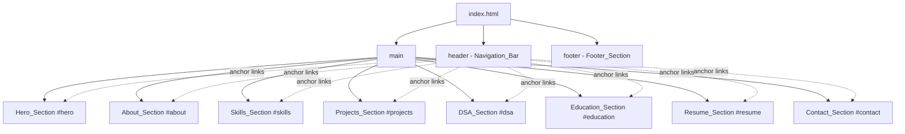
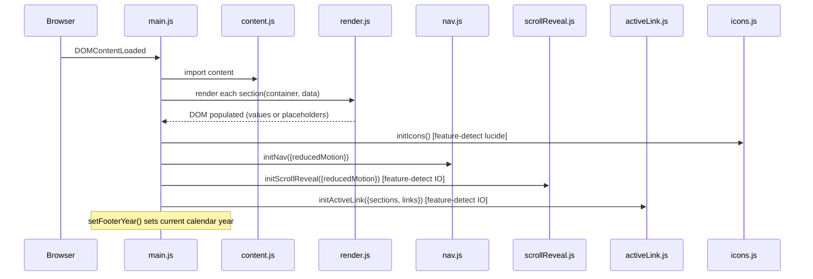
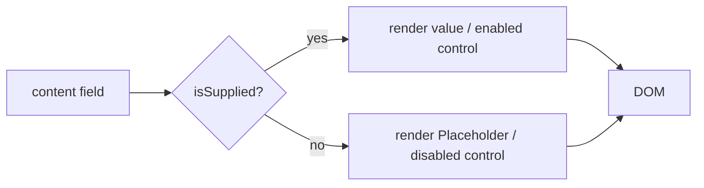
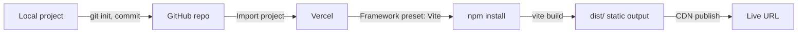

# Design Document

## Overview

The Portfolio_Site is a recruiter-focused, single-page portfolio for Prem Chandu Appala, a third-year B.Tech Computer Science student. It is a fully static site: one `index.html`, a modular CSS layer, and a small set of vanilla JavaScript modules, built and bundled with Vite and deployed to Vercel. There is no backend, no database, and no paid third-party service.

The design targets a premium, futuristic aesthetic on a charcoal / near-black canvas with a single cool accent (teal). The experience is calm, fast, and legible: strong type, generous spacing, restrained motion, and an accent reserved strictly for emphasis and focus. Every interaction is keyboard-operable and respects the visitor's reduced-motion preference.

Two principles shape every decision in this document:

- **Honesty (Requirement 18).** The only asserted facts are the ones supplied and verified: the candidate's name, degree program and year, and the two named projects with their stated stacks. Everything else — email, social URLs, demo/repo links, institution, graduation year, scores, resume PDF — is modeled as a nullable field that renders a clearly identifiable **Placeholder** until the candidate supplies a verified value. No statistics, achievements, or metrics are invented.
- **Single source of truth.** All personal content lives in one editable data module (`src/data/content.js`). The HTML provides semantic scaffolding; JavaScript hydrates it from the data module. To update the site, the candidate edits one file and drops optional assets (resume PDF, OG image) into `public/`.

### Technology Summary

| Concern | Choice | Requirement |
| --- | --- | --- |
| Markup | HTML5 semantic landmarks | 17.1 |
| Styling | CSS3 with custom properties (design tokens) | 17.1 |
| Behavior | Vanilla JavaScript ES modules, no framework | 17.1 |
| Build tool | Vite | 17.2 |
| Icons | Lucide | 17.4 |
| Hosting | Vercel static deploy, environment-free | 17.3, 17.5 |
| Source control | GitHub | 17 (intro) |

## Architecture

### High-Level Approach

`index.html` is the only document. It declares the head metadata (title, description, Open Graph, favicon) and a `<body>` containing a persistent `<header>` navigation landmark, a `<main>` with nine `<section>` landmarks (Hero through Contact), and a `<footer>`. Each navigable section carries a unique `id` used both as the anchor target and the scroll-spy observation target.

Content is not hard-coded into the sections. Instead, each section shell contains stable container elements (known `id`s / `data-*` hooks). On load, `main.js` imports the central `content` object and calls one render function per section, which populates the shells from data and substitutes placeholders for any null/empty field. This keeps the honesty rules and all personal data in exactly one place.

JavaScript is organized as small, single-responsibility ES modules so each can be reasoned about and tested in isolation:

- `data/content.js` — the single content/config source of truth.
- `js/dom.js` — pure DOM/rendering helpers (`isSupplied`, `placeholder`, `externalLink`, `el`).
- `js/render.js` — per-section render functions consuming `content`.
- `js/nav.js` — hamburger toggle, menu close-on-select, smooth-scroll with reduced-motion guard.
- `js/scrollReveal.js` — IntersectionObserver-based reveal with feature-detection and reduced-motion guard.
- `js/activeLink.js` — IntersectionObserver-based active-link / `aria-current` highlighting.
- `js/icons.js` — Lucide initialization with feature-detection.
- `main.js` — entry point; wires everything on `DOMContentLoaded`.

### CSS Architecture

CSS is layered from most abstract to most concrete and imported once (via `main.js` or an `index.css` barrel) so cascade order is deterministic:

1. `tokens.css` — design tokens as `:root` custom properties (color, type, spacing, radius, shadow, motion). Single source of truth for the visual system.
2. `reset.css` — a minimal modern reset (box-sizing, margin normalization, media defaults, `prefers-reduced-motion` global dampening).
3. `base.css` — element defaults: body background/foreground, link color, heading rhythm, `:focus-visible` ring, selection color.
4. `layout.css` — page container, section spacing, nav layout, responsive grids (skills, projects, DSA, contact).
5. `components.css` — nav, buttons/CTAs, cards, tags/badges, placeholder styling, disabled control styling, icons.
6. `utilities.css` — small helpers (visually-hidden, container widths, reveal animation classes).

### Page Composition



### Initialization Flow



### Data Flow for a Single Field

Every renderable field passes through one decision: is it a **Supplied Value**? This is the mechanism that enforces Requirement 18.



### Vite Configuration

Vite serves the project in development and produces a static bundle for production. Because this is a single HTML entry with co-located assets, the default Vite static build is sufficient; `vite.config.js` pins the `root`, `base`, and `build.outDir` so Vercel can deploy the `dist/` output directly.

```js
// vite.config.js
import { defineConfig } from 'vite';

export default defineConfig({
  root: '.',
  base: '/',
  build: {
    outDir: 'dist',
    emptyOutDir: true,
    target: 'es2019',
  },
});
```

Lucide is installed as an npm dependency and imported in `js/icons.js`, so no CDN or external runtime dependency is required (supports Requirement 16.2 — no console errors from failed network calls, and 17.3 — no third-party service).

## Design System / Visual Design

All visual values are defined once as CSS custom properties in `tokens.css`. The palette is engineered so that every body-text pairing meets WCAG AA (≥ 4.5:1) and every interactive boundary / focus pairing meets ≥ 3:1, satisfying Requirement 12.4 and 12.5.

### Color Tokens

Charcoal / near-black surfaces at four elevations, muted foreground tints, and a single teal accent with a hover/focus variant.

```css
:root {
  /* Surfaces — charcoal / near-black, increasing elevation */
  --surface-0: #0B0E11; /* page background (primary surface) */
  --surface-1: #12161B; /* cards, nav bar */
  --surface-2: #1A2027; /* hover / raised card */
  --surface-3: #232B34; /* subtle dividers, inset wells */

  /* Foreground tints (all measured on --surface-0) */
  --fg:        #E6EDF3; /* primary text   ~16.4:1  */
  --fg-muted:  #A7B4C0; /* secondary text ~9.2:1   */
  --fg-subtle: #7D8B99; /* tertiary text  ~5.5:1   */

  /* Accent — single cool color (teal family) */
  --accent:       #2DD4BF; /* ~10.4:1 on --surface-0 */
  --accent-hover: #5EEAD7; /* brighter hover/active state */
  --accent-soft:  rgba(45, 212, 191, 0.12); /* tinted fills */
  --on-accent:    #06231F; /* near-black text on accent fills (~9:1) */

  /* Borders */
  --border:        #232B34; /* decorative dividers (non-interactive) */
  --border-strong: #6E7B8A; /* interactive control boundaries  ≥3:1 */

  /* Status */
  --placeholder-fg: #C9A24B; /* amber — marks un-supplied values, distinct from accent */
}
```

**Contrast verification (computed, sRGB):**

| Pairing | Ratio | Rule | Requirement |
| --- | --- | --- | --- |
| `--fg` on `--surface-0` | ~16.4:1 | body text ≥ 4.5 | 12.4 |
| `--fg-muted` on `--surface-0` | ~9.2:1 | body text ≥ 4.5 | 12.4 |
| `--fg-subtle` on `--surface-0` | ~5.5:1 | body text ≥ 4.5 | 12.4 |
| `--accent` on `--surface-0` | ~10.4:1 | text/boundary | 12.4, 12.5 |
| `--on-accent` on `--accent` | ~9:1 | button label | 12.4 |
| `--border-strong` on `--surface-1` | ~4.2:1 | control boundary ≥ 3 | 12.5 |
| `--accent` focus ring on `--surface-1` | ~9.8:1 | focus indicator ≥ 3 | 12.5 |

The accent is used **only** for emphasis: CTA fills, link/interactive text, active nav state, tag accents, and the focus ring (Requirement 12.3). Large neutral surfaces never use it.

### Typography

A refined sans for UI/body and a monospace for labels, section numbering, tags, and code-flavored accents. Inter is bundled locally (self-hosted via an npm font package or `public/` woff2) so there is no external font request; a system stack is the fallback.

```css
:root {
  --font-sans: 'Inter', system-ui, -apple-system, 'Segoe UI', Roboto, sans-serif;
  --font-mono: 'JetBrains Mono', ui-monospace, 'SF Mono', Menlo, Consolas, monospace;

  /* Type scale — ~1.25 modular, fluid headings via clamp() */
  --fs-xs:   0.75rem;   /* 12px — tags, eyebrow labels (mono) */
  --fs-sm:   0.875rem;  /* 14px — captions, meta */
  --fs-base: 1rem;      /* 16px — body */
  --fs-md:   1.125rem;  /* 18px — lead paragraph */
  --fs-lg:   1.375rem;  /* 22px — card titles */
  --fs-xl:   clamp(1.5rem, 1.1rem + 1.6vw, 1.875rem);  /* section headings */
  --fs-2xl:  clamp(2rem, 1.4rem + 2.6vw, 2.75rem);     /* sub-hero */
  --fs-3xl:  clamp(2.5rem, 1.6rem + 4vw, 4rem);        /* hero name */

  --lh-tight: 1.15;
  --lh-snug:  1.3;
  --lh-base:  1.6;
  --fw-regular: 400;
  --fw-medium:  500;
  --fw-semibold: 600;
  --fw-bold:    700;
  --tracking-label: 0.08em; /* letter-spacing for mono eyebrow labels */
}
```

### Spacing, Radius, Shadow, Motion

```css
:root {
  /* Spacing — 4px base, 8-point rhythm */
  --space-1: 0.25rem;  --space-2: 0.5rem;  --space-3: 0.75rem;
  --space-4: 1rem;     --space-5: 1.5rem;  --space-6: 2rem;
  --space-8: 3rem;     --space-10: 4rem;   --space-12: 6rem;
  --section-pad-y: clamp(3rem, 6vw, 6rem);
  --container-max: 72rem; /* 1152px */

  /* Radius */
  --radius-sm: 6px; --radius-md: 10px; --radius-lg: 16px; --radius-pill: 999px;

  /* Elevation — subtle on dark, plus a restrained accent glow for emphasis */
  --shadow-1: 0 1px 2px rgba(0,0,0,0.4);
  --shadow-2: 0 8px 24px rgba(0,0,0,0.45);
  --glow-accent: 0 0 0 1px var(--accent-soft), 0 8px 32px rgba(45,212,191,0.12);

  /* Motion */
  --dur-fast: 120ms; --dur-base: 200ms; --dur-slow: 400ms;
  --ease-out: cubic-bezier(0.16, 1, 0.3, 1);
  --ease-standard: cubic-bezier(0.4, 0, 0.2, 1);
}
```

### Focus-Visible Ring

A single, consistent focus treatment on all interactive controls (Requirement 13.2, 12.5):

```css
:where(a, button, [tabindex]):focus-visible {
  outline: 2px solid var(--accent);
  outline-offset: 2px;
  border-radius: var(--radius-sm);
}
```

### Placeholder Styling

Placeholders must be visually distinguishable from supplied content (Glossary; Requirement 18.2). They use the amber `--placeholder-fg`, a dashed border for link/control placeholders, the mono font, and an explicit textual marker, plus `aria`/`title` so assistive tech announces them.

```css
.is-placeholder {
  font-family: var(--font-mono);
  color: var(--placeholder-fg);
  font-size: var(--fs-sm);
}
.is-placeholder--control {
  border: 1px dashed var(--placeholder-fg);
  border-radius: var(--radius-sm);
  padding: var(--space-2) var(--space-3);
  background: transparent;
}
```

### Reduced-Motion Global Guard

```css
@media (prefers-reduced-motion: reduce) {
  *, *::before, *::after {
    animation-duration: 0.01ms !important;
    animation-iteration-count: 1 !important;
    transition-duration: 0.01ms !important;
    scroll-behavior: auto !important;
  }
}
```

JavaScript reads the same signal (`matchMedia('(prefers-reduced-motion: reduce)')`) so programmatic scrolling and reveal are also suppressed (Requirements 2.6, 13.5).

## Components and Interfaces

Each section is a component: a semantic HTML shell plus a render function that consumes fields from the central `content` object. Every external link is produced by the shared `externalLink` helper so `target="_blank"` and `rel="noopener noreferrer"` are applied uniformly (Requirements 6.7, 7.5, 10.6). Every optional field passes through `isSupplied` / `placeholder` so un-supplied data renders an identifiable placeholder (Requirement 18.2).

### Shared DOM Helpers (`js/dom.js`)

| Function | Responsibility |
| --- | --- |
| `isSupplied(value)` | Returns `true` only when `value` is non-null, non-undefined, and (for strings) non-empty after trimming. The single gate for the honesty rule. |
| `el(tag, props, children)` | Tiny element factory (sets text, attributes, class, children). Avoids `innerHTML` injection. |
| `placeholder(label, kind)` | Returns a placeholder node with class `is-placeholder`, mono styling, and `title`/`aria-label`; `kind: 'text' \| 'control'`. |
| `externalLink({ url, label, fallbackLabel })` | If `isSupplied(url)`, returns an `<a target="_blank" rel="noopener noreferrer">`; otherwise returns a `placeholder(fallbackLabel, 'control')`. |
| `mountInto(container, node)` | Clears and appends; no-ops safely if `container` is null (guards against missing shells — Requirement 16.2). |

### 1. Navigation_Bar (`header`, `js/nav.js`)

**Structure:** persistent `<header>` with a brand mark, a `<nav aria-label="Primary">` containing one anchor link per navigable section (Hero, About, Skills, Projects, DSA, Education, Resume, Contact), and a `<button class="nav-toggle" aria-controls aria-expanded>` hamburger shown at ≤ 768px.

**Data consumed:** the nav link list is derived from a static section registry (`{ id, label }[]`) shared with the active-link module so links, anchors, and scroll-spy stay in sync.

**Interface (`js/nav.js`):**

- `initNav({ header, toggle, menu, sections, prefersReducedMotion })` — wires all nav behavior.
- `toggleMenu(open)` — sets `aria-expanded` and the menu's visible state (Requirements 2.3, 2.4).
- `closeMenu()` — called when any anchor link is selected (Requirement 2.5).
- `smoothScrollTo(id, prefersReducedMotion)` — scrolls the target section into view; uses `behavior: 'smooth'` normally and `behavior: 'auto'` when reduced motion is set (Requirements 2.2, 2.6). Resolves the target element first and no-ops if absent (Requirement 16.1).

### 2. Hero_Section (`#hero`, `renderHero`)

**Structure:** the candidate name as the page's single `<h1>`, a headline, and at least one CTA group.

**Data consumed:** `profile.name` ("Prem Chandu Appala"), `profile.headline` (third-year B.Tech Computer Science student), CTAs linking to `#projects` and `#contact`.

**Behavior:** CTAs are in-page anchors (Requirement 3.3) routed through `smoothScrollTo`. Name and headline are fixed supplied values (Requirements 3.1, 3.2).

### 3. About_Section (`#about`, `renderAbout`)

**Structure:** section heading + a professional summary paragraph, optional highlight list.

**Data consumed:** `about.summary`, `about.highlights[]`. Any biographical detail that is not supplied renders a placeholder in place (Requirement 4.2); the summary itself falls back to a placeholder if empty.

### 4. Skills_Section (`#skills`, `renderSkills`)

**Structure:** labeled category groups; each group renders its skills as mono tags/badges.

**Data consumed:** `skills: { category, items[] }[]`. Only supplied items render (Requirement 5.2); an empty category renders a placeholder tag indicating skills are pending (Requirements 5.1, 5.3). Every rendered skill is always nested under a labeled category.

### 5. Projects_Section (`#projects`, `renderProjects`)

**Structure:** a responsive grid of project cards. Each card: title, tagline, verified description bullets, a stack tag row, and a link row (Live Demo, Source).

**Data consumed:** `projects[]` with `name`, `tagline`, `description[]`, `stack[]`, `demoUrl`, `repoUrl`.

- RepairHub card — "smart repair quote comparison and service booking platform", stack `PHP`, `MySQL` (Requirement 6.1).
- LifeLink card — "blood donor finder platform", stack `Vite`, `JavaScript`, `Bootstrap 5`, `Supabase` (Requirement 6.2).
- Every entry in `stack[]` renders as a tag (Requirement 6.3).
- Description bullets describe only supplied, verified functionality (Requirements 6.4, 18.5).
- `demoUrl` / `repoUrl`: when supplied, rendered via `externalLink` (new tab, `rel=noopener noreferrer`) — Requirements 6.5, 6.7; when null, rendered as a control placeholder — Requirement 6.6.

### 6. DSA_Section (`#dsa`, `renderDsa`)

**Structure:** a grid of three minimal profile link cards.

**Data consumed:** `dsaProfiles: { platform, url }[]` for LeetCode, Codeforces, HackerRank (Requirement 7.1). Each card is restricted to the platform name plus the profile link/placeholder — no counts, ratings, or statistics (Requirement 7.2, reinforcing 18.1). Supplied URLs render via `externalLink` (Requirements 7.3, 7.5); null URLs render a placeholder (Requirement 7.4).

### 7. Education_Section (`#education`, `renderEducation`)

**Structure:** a card listing degree, year, institution, graduation year, and any supplied scores.

**Data consumed:** `education.degree` ("B.Tech in Computer Science", Requirement 8.1), `education.year` ("Third year", Requirement 8.2), `education.institution`, `education.graduationYear`, `education.scores[]`. Only supplied scores render (Requirement 8.3); institution, graduation year, and absent scores render placeholders (Requirement 8.4).

### 8. Resume_Section (`#resume`, `renderResume`)

**Structure:** a short line plus a single download control.

**Data consumed:** `resume.pdfPath`.

- Supplied: an enabled `<a class="btn" href="{pdfPath}" download>Download Resume</a>` (Requirements 9.1, 9.2).
- Null: a disabled control (`<button class="btn" disabled aria-disabled="true">`) that cannot be activated, plus a placeholder note "Resume not yet available" (Requirements 9.3, 9.4, 9.5).

### 9. Contact_Section (`#contact`, `renderContact`)

**Structure:** a row of direct links only — no form, no fetch, no backend (Requirement 10.1).

**Data consumed:** `links.email`, `links.linkedin`, `links.github`.

- Email: supplied → `<a href="mailto:{email}">` opening the default mail client (Requirements 10.2, 10.5); null → placeholder (Requirement 10.7).
- LinkedIn / GitHub: supplied → `externalLink` (new tab, Requirements 10.3, 10.4, 10.6); null → placeholder (Requirement 10.7).

### 10. Footer_Section (`footer`, `renderFooter`)

**Structure:** candidate name, dynamic copyright line, GitHub + LinkedIn links.

**Data consumed:** `profile.name` (Requirement 11.1), `links.github`, `links.linkedin` (Requirement 11.3, placeholders when null per 11.4). The year is computed at render via `new Date().getFullYear()` (Requirement 11.2), not stored in data.

### Enhancement Modules

**Scroll-reveal (`js/scrollReveal.js`)**

- `initScrollReveal({ selector = '[data-reveal]', prefersReducedMotion })` — if `IntersectionObserver` is unavailable **or** reduced motion is set, immediately add the `is-visible` class to all targets (content always shown); otherwise observe and reveal on entry, unobserving after (Requirements 13.5, 16.2).

**Active-link highlighting (`js/activeLink.js`)**

- `initActiveLink({ sections, links })` — observes section landmarks; toggles `aria-current="true"` and an `.is-active` class on the matching nav link. Feature-detects `IntersectionObserver` and no-ops cleanly if absent.

**Icons (`js/icons.js`)**

- `initIcons()` — imports and runs Lucide's `createIcons`; wrapped in a guard so a load failure degrades to the icon's text alternative rather than throwing (Requirements 17.4, 13.4, 16.2). All non-decorative icons get `aria-label`; purely decorative icons get `aria-hidden="true"`.

## Data Models

The entire editable surface is one object exported from `src/data/content.js`. Fields marked nullable render a placeholder when `null`/empty. No field may contain an unverified statistic, score, or metric (Requirement 18.1).

```js
// src/data/content.js
export const sections = [
  { id: 'hero', label: 'Home' },
  { id: 'about', label: 'About' },
  { id: 'skills', label: 'Skills' },
  { id: 'projects', label: 'Projects' },
  { id: 'dsa', label: 'DSA' },
  { id: 'education', label: 'Education' },
  { id: 'resume', label: 'Resume' },
  { id: 'contact', label: 'Contact' },
];

export const content = {
  profile: {
    name: 'Prem Chandu Appala',            // supplied, fixed
    headline: 'Third-year B.Tech Computer Science student', // supplied, fixed
    tagline: null,                         // nullable -> placeholder
  },

  links: {
    email: null,                           // nullable -> placeholder (mailto)
    github: null,                          // nullable -> placeholder (new tab)
    linkedin: null,                        // nullable -> placeholder (new tab)
  },

  about: {
    summary: null,                         // nullable -> placeholder paragraph
    highlights: [],                        // only supplied, verified items
  },

  skills: [
    { category: 'Languages', items: [] },             // only supplied items
    { category: 'Frameworks & Libraries', items: [] },
    { category: 'Databases', items: [] },
    { category: 'Tools & Platforms', items: [] },
  ],

  projects: [
    {
      name: 'RepairHub',
      tagline: 'Smart repair quote comparison and service booking platform',
      description: [],                     // only verified functionality (18.5)
      stack: ['PHP', 'MySQL'],             // supplied, fixed (6.1)
      demoUrl: null,                       // nullable -> placeholder (6.6)
      repoUrl: null,                       // nullable -> placeholder (6.6)
    },
    {
      name: 'LifeLink',
      tagline: 'Blood donor finder platform',
      description: [],                     // only verified functionality (18.5)
      stack: ['Vite', 'JavaScript', 'Bootstrap 5', 'Supabase'], // supplied (6.2)
      demoUrl: null,
      repoUrl: null,
    },
  ],

  dsaProfiles: [
    { platform: 'LeetCode', url: null },   // name + link only (7.2)
    { platform: 'Codeforces', url: null },
    { platform: 'HackerRank', url: null },
  ],

  education: {
    degree: 'B.Tech in Computer Science',  // supplied, fixed (8.1)
    year: 'Third year',                    // supplied, fixed (8.2)
    institution: null,                     // nullable -> placeholder (8.4)
    graduationYear: null,                  // nullable -> placeholder (8.4)
    scores: [],                            // only supplied scores (8.3)
  },

  resume: {
    pdfPath: null,                         // null -> disabled control (9.3-9.5)
  },

  seo: {
    title: 'Prem Chandu Appala — B.Tech CS Student & Developer',
    description: 'Portfolio of Prem Chandu Appala, a third-year B.Tech Computer Science student and software developer.',
    ogImage: '/og-image.png',              // optional asset; absence is non-fatal
  },
};
```

### Field Semantics

| Field | Type | Supplied rule | Un-supplied rendering |
| --- | --- | --- | --- |
| `profile.name`, `profile.headline` | string (fixed) | always shown | n/a |
| `links.{email,github,linkedin}` | string \| null | shown as mailto / external link | placeholder control |
| `about.summary` | string \| null | shown as paragraph | placeholder paragraph |
| `skills[].items` | string[] | each item shown as tag | placeholder tag per empty category |
| `projects[].description` | string[] | verified bullets only | placeholder "details coming soon" |
| `projects[].stack` | string[] (fixed) | every entry shown as tag | n/a |
| `projects[].{demoUrl,repoUrl}` | string \| null | external link | placeholder control |
| `dsaProfiles[].url` | string \| null | external link | placeholder control |
| `education.{institution,graduationYear}` | string \| null | shown | placeholder |
| `education.scores` | array | supplied scores only | omitted / placeholder |
| `resume.pdfPath` | string \| null | enabled download | disabled control + note |

This table is the honesty contract from Requirement 18: the default state of the repository ships with every personal detail `null`/empty so nothing false is ever asserted, and the candidate fills values in one file as they verify them.

## Error Handling

The site must load and run without console errors (Requirement 16.2) even when optional data and assets are absent.

| Condition | Handling | Requirement |
| --- | --- | --- |
| Nullable field is `null`/empty | `isSupplied` returns false → `placeholder(...)` rendered; no broken link, no empty control | 4.2, 5.3, 6.6, 7.4, 8.4, 10.7, 11.4, 18.2, 18.3 |
| Resume PDF not supplied | Disabled control (`disabled` + `aria-disabled`) that cannot activate, plus placeholder note | 9.3–9.5 |
| Section shell container missing from DOM | `mountInto` guards null containers and returns silently | 16.2 |
| Nav target id does not resolve | `smoothScrollTo` resolves element first; no-ops if absent instead of throwing | 16.1, 16.2 |
| `IntersectionObserver` unavailable | Scroll-reveal reveals all content immediately; active-link silently disabled | 16.2 |
| Lucide fails to load / init | `initIcons` guarded in try/catch; icons degrade to text alternatives | 13.4, 16.2, 17.4 |
| Reduced-motion preference set | JS uses `behavior:'auto'`; CSS dampens animation/transition | 2.6, 13.5 |
| OG image asset absent | Referenced by path only; missing file does not affect runtime JS/CSS | 14.3, 16.2 |
| External URL supplied | Always `rel="noopener noreferrer"` to avoid `window.opener` exposure | 6.7, 7.5, 10.6 |
| Secrets in source | None exist; no API keys, no backend calls, nothing to leak | 18.4 |

All rendering avoids `innerHTML` with interpolated data (uses the `el` factory and `textContent`), eliminating injection-driven runtime errors and keeping the console clean.

## Correctness Properties

*A property is a characteristic or behavior that should hold true across all valid executions of a system — essentially, a formal statement about what the system should do. Properties serve as the bridge between human-readable specifications and machine-verifiable correctness guarantees.*

The properties below are derived from the acceptance-criteria prework. Overlapping criteria (every section's "null → placeholder" rule, every "open in new tab" rule, the nav/anchor rules) have been consolidated so each property provides unique validation value. Properties are verified with a property-based testing library (fast-check) running the render modules against a DOM (jsdom), minimum 100 iterations per property.

### Property 1: Un-supplied fields render identifiable placeholders

For any content object in which one or more nullable fields (about summary, skill items, project demo/repo URL, DSA profile URL, education institution / graduation year / score, resume path, contact email / LinkedIn / GitHub, footer link) is null, undefined, or whitespace-only, the rendered output for that field is an identifiable placeholder (carrying the `is-placeholder` marker) and never a broken link, empty control, or fabricated value.

**Validates: Requirements 4.2, 5.3, 6.6, 7.4, 8.4, 10.7, 11.4, 18.2, 18.3**

### Property 2: Supplied values are rendered faithfully with no fabrication

For any content object, every data value that appears in the rendered output traces back to a supplied field in that object, and every supplied (non-empty) field appears in the output; the renderer never invents skills, scores, descriptions, metrics, or any content not present in the data.

**Validates: Requirements 5.2, 6.4, 8.3, 18.1**

### Property 3: Supplied external links open safely in a new tab

For any supplied external URL rendered anywhere (project demo/repo, DSA profile, contact LinkedIn/GitHub, footer links), the produced anchor has `href` equal to the supplied URL, `target="_blank"`, and a `rel` attribute containing both `noopener` and `noreferrer`.

**Validates: Requirements 6.5, 6.7, 7.3, 7.5, 10.3, 10.4, 10.6, 11.3**

### Property 4: Supplied email renders a mailto control

For any supplied email address, the contact email control's `href` equals `"mailto:"` concatenated with that address, so activation opens the visitor's default mail client.

**Validates: Requirements 10.2, 10.5**

### Property 5: Resume control reflects supply state

For any resume configuration: when `pdfPath` is supplied, the control is an enabled download anchor whose `href` equals `pdfPath` and which carries the `download` attribute; when `pdfPath` is null, the control is disabled (cannot be activated and exposes no navigable href) and is accompanied by a placeholder note indicating the resume is not yet available.

**Validates: Requirements 9.1, 9.2, 9.3, 9.4, 9.5**

### Property 6: Every rendered skill sits under a labeled category

For any skills dataset, each rendered skill tag has an ancestor group that carries a non-empty category label; no skill is rendered outside a labeled category.

**Validates: Requirements 5.1**

### Property 7: Every project stack entry renders as a tag

For any project, each entry in its `stack` array is rendered as exactly one stack tag on that project's card, and the set of rendered tags equals the supplied stack set.

**Validates: Requirements 6.3**

### Property 8: Navigation and anchors are complete and resolvable

For any section registry, the renderer produces one section landmark per entry with a unique anchor id, one navigation link per entry, and every navigation link's target resolves to an existing section id on the page.

**Validates: Requirements 1.1, 1.3, 2.1, 16.1**

### Property 9: DSA cards are limited to platform name and link

For any DSA profiles dataset, the renderer produces exactly one card per configured platform, and each card's content is limited to the platform name plus a profile link or placeholder — containing no coding statistics, ratings, or numeric metrics.

**Validates: Requirements 7.1, 7.2**

### Property 10: Footer copyright shows the current calendar year

For any system date, the rendered footer copyright text contains the year returned by `new Date().getFullYear()` at render time.

**Validates: Requirements 11.2**

### Property 11: Reduced-motion preference suppresses non-essential motion

For any navigation action and any scroll-reveal initialization performed while the reduced-motion preference is set, programmatic scrolling uses non-animated behavior and reveal targets are shown immediately without entrance animation.

**Validates: Requirements 2.6, 13.5**

### Property 12: Palette pairings meet contrast thresholds

For any body-text color token paired with the surface it is used on, the computed contrast ratio is at least 4.5:1; and for any interactive-control boundary or focus-indicator token paired with its adjacent color, the computed contrast ratio is at least 3:1.

**Validates: Requirements 12.4, 12.5**

### Property 13: Non-decorative icons and images carry text alternatives

For any rendered icon or image, if it is non-decorative it carries a non-empty text alternative (`aria-label` or `alt`), and if it is decorative it is marked `aria-hidden="true"`.

**Validates: Requirements 13.4**

### Property 14: Menu toggle is reversible and closes on selection

For any initial menu state, invoking the hamburger toggle twice restores the original `aria-expanded` state (a single toggle flips it), and selecting any anchor link from an open menu leaves the menu closed.

**Validates: Requirements 2.4, 2.5**

### Property 15: Supplied URLs are well-formed

For any supplied link URL (project, DSA, contact, footer), the value parses as a valid absolute `http`/`https` URL, so no supplied link is rendered in a malformed state.

**Validates: Requirements 16.3**

## Testing Strategy

The portfolio combines **property-based tests** and **example-based unit tests** for render logic (run in jsdom via Vitest + fast-check) with a **manual + tooling checklist** for the visual, responsive, accessibility, and deployment concerns that are not pure functions.

### Automated Tests

**Property tests (fast-check, minimum 100 iterations each):** implement Properties 1–15 above. Each test is tagged `Feature: prem-portfolio, Property {number}: {property text}` and references the design property it validates. Generators produce arbitrary content objects — including null, empty, and whitespace fields, arbitrary skill/stack/score arrays, arbitrary URLs, and mocked system dates and `matchMedia` results — to exercise the honesty, link-safety, and reduced-motion logic across the full input space.

**Unit tests (example-based):** cover the fixed-value and single-scenario criteria classified as EXAMPLE in prework — hero name/headline (3.1, 3.2), at-least-one CTA (3.3), About supplied summary (4.1), RepairHub/LifeLink cards and stacks (6.1, 6.2), degree/year (8.1, 8.2), resume download attribute (9.2), mailto scheme (10.5), footer name (11.1), smooth-scroll request when motion allowed (2.2), menu-close-on-select concrete case (2.5), focus-visible rule application (13.2), and the SEO head metadata (14.1–14.4).

### Manual + Tooling Checklist

| Check | How | Requirements |
| --- | --- | --- |
| Responsive layout | Resize / device emulation at 320, 768, 900 (tablet), 1024, and ≥1280; confirm single-column ≤768, tablet 769–1024, desktop >1024 | 15.1, 15.2, 15.3 |
| No horizontal overflow | Inspect for horizontal scrollbar at 320/768/1024/desktop | 15.4 |
| Hamburger behavior | At ≤768 confirm toggle appears, opens/closes, closes on link select | 2.3 |
| Keyboard-only traversal | Tab through every control in order; confirm all reachable and operable | 13.1, 13.3 |
| Visible focus | Tab and confirm the accent focus ring is clearly visible on each control | 13.2 |
| Reduced motion | Enable OS reduced-motion; confirm no animated scroll or reveal | 2.6, 13.5 |
| Contrast / a11y audit | Run axe DevTools and a contrast checker on text, controls, focus ring | 12.4, 12.5, 13.1, 13.4 |
| Accent discipline | Visual review that the accent appears only on emphasis/controls/focus | 12.3 |
| Lighthouse | Run Performance / Accessibility / SEO / Best-Practices audits | 12, 13, 14 |
| Console cleanliness | Load and exercise nav/toggle/links; confirm zero console errors | 16.2 |
| Link resolution | Click every supplied link; confirm it resolves and opens correctly | 16.1, 16.3 |
| Cross-browser sanity | Smoke test in Chromium, Firefox, and WebKit/Safari | 16.2 |
| Toolchain / build | `npm run build` produces `dist`; inspect deps for no framework, Vite present, Lucide used | 17.1, 17.2, 17.4, 17.5 |
| Static / secret scan | Confirm no backend calls, no paid SDK, no secrets in source or bundle | 17.3, 18.4 |

### Testing Principles

- Property tests cover universal input variation (nullability, link safety, grouping, dates, reduced motion, contrast); unit tests pin concrete fixed content and single scenarios; manual/tooling covers visual, responsive, runtime, and build concerns that are not pure functions.
- A feature's description in `content.js` stays empty until that feature is verified, operationalizing Requirement 18.5.
- Tests run in CI-friendly single-run mode (`vitest run`), never watch mode.

## File / Folder Structure

```text
prem-portfolio/
├─ index.html                 # single page: head metadata + semantic section shells
├─ public/                    # copied as-is to build root
│  ├─ favicon.svg             # referenced favicon (14.4)
│  ├─ og-image.png            # Open Graph image (optional; absence non-fatal)
│  └─ resume.pdf              # optional; absent by default -> disabled control
├─ src/
│  ├─ main.js                 # entry: imports styles + content, wires modules
│  ├─ data/
│  │  └─ content.js           # SINGLE source of truth for all personal content
│  ├─ js/
│  │  ├─ dom.js               # isSupplied, el, placeholder, externalLink, mountInto
│  │  ├─ render.js            # renderHero/About/Skills/Projects/Dsa/Education/Resume/Contact/Footer
│  │  ├─ nav.js               # hamburger toggle, close-on-select, smooth scroll
│  │  ├─ scrollReveal.js      # IntersectionObserver reveal + reduced-motion guard
│  │  ├─ activeLink.js        # scroll-spy active nav link / aria-current
│  │  └─ icons.js             # Lucide init (feature-detected)
│  └─ styles/
│     ├─ tokens.css           # design tokens (color, type, spacing, radius, shadow, motion)
│     ├─ reset.css            # modern reset + global reduced-motion dampening
│     ├─ base.css             # element defaults, focus-visible ring
│     ├─ layout.css           # container, section spacing, responsive grids
│     ├─ components.css       # nav, buttons, cards, tags, placeholders
│     └─ utilities.css        # visually-hidden, reveal classes, helpers
├─ tests/
│  ├─ properties.test.js      # Properties 1–15 (fast-check)
│  └─ units.test.js           # example-based unit tests
├─ vite.config.js
├─ vercel.json                # optional; default Vite preset works without it
├─ package.json
├─ .gitignore                 # node_modules, dist, .DS_Store, editor dirs
└─ README.md                  # setup, edit-content guide, build & deploy steps
```

The structure keeps the three edit surfaces obvious: **content** (`src/data/content.js`), **look** (`src/styles/tokens.css`), and **optional assets** (`public/`). Everything else is plumbing the candidate rarely touches.

## Deployment Plan

The site is environment-free: no environment variables, no secrets, no server. Deployment is a static build published to Vercel.



1. **Initialize GitHub repository.** `git init`, commit the project (with `.gitignore` excluding `node_modules` and `dist`), and push to a new GitHub repo.
2. **Local build verification.** `npm install` then `npm run build`; Vite emits the static site to `dist/`. Preview with `npm run preview` to confirm the production bundle (Requirements 17.2, 17.5).
3. **Import to Vercel.** Connect the GitHub repo in Vercel. Vercel auto-detects the Vite preset:
   - Build command: `vite build` (or `npm run build`)
   - Output directory: `dist`
   - Install command: `npm install`
   - No environment variables required (Requirement 17.3).
4. **`vercel.json` (optional).** Not required for a single-page static build; the default Vite preset serves `index.html` and `public/` assets directly. It can be added later only if custom headers or caching rules are desired.
5. **Post-deploy verification.** On the live URL, run the manual + tooling checklist (Lighthouse, axe, console-error check, link resolution, responsive and reduced-motion checks) to confirm the deployed build satisfies Requirements 12–16.
6. **Content updates.** To publish changes, the candidate edits `src/data/content.js` (and drops `public/resume.pdf` / `public/og-image.png` when available), commits, and pushes; Vercel rebuilds and redeploys automatically.
